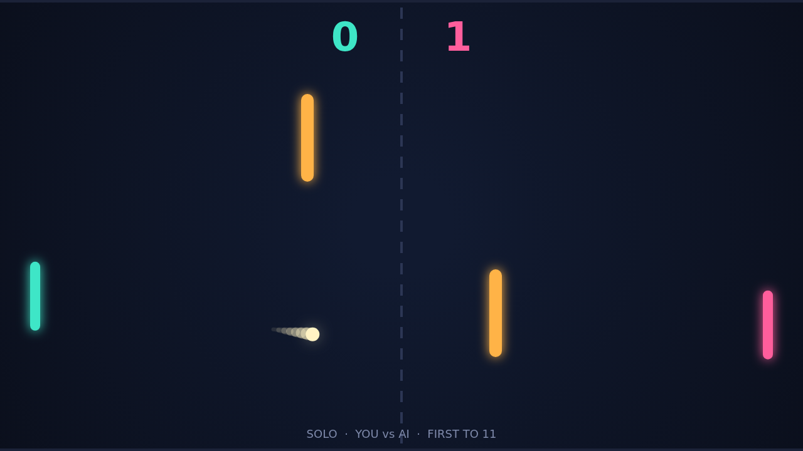

# Carom

Carom is a paddle duel seen from above: two paddles, one ball, a dark field, and
two bars standing in the middle of it. You hold the left paddle and the AI holds
the right, or a friend takes the arrow keys and the right side is theirs. The
ball passes the far edge behind a paddle and the other player scores. First to
eleven wins, and you have to win by two.

A match opens with the ball resting at the center of the field. A ring tightens
around it for a second, and then it leaves toward the left side at a shallow
angle. The opening rally is a feeling-out: the ball comes back flat, the two bars
stay out of the way, and the paddles trade straight returns across the net. Then
someone meets the ball with a moving paddle, and the match changes shape.

That is the spin. Strike the ball while your paddle is moving and its flight
curves in the direction you were moving, hardest right after the hit and fading
over the next second. A return that looked like it was going long bends back
onto the field. A ball headed straight at the AI's paddle peels away at the last
moment. Each paddle hit also makes the ball a little faster, so a long rally
tightens until one player's reach runs out.

The two bars are where the curve pays off. A straight shot through the middle
clips one and bounces back at full speed, so the field plays like a bank-shot
table: aim through the gaps, or put enough spin on the ball to wrap around a bar
and come at your opponent from an angle they did not set up for. The trail
behind the ball shows the curve as it happens, so you can see the shot you hit
and the one that is coming.

At match point the field feels small. The ball is near its top speed, the AI is
tracking it with a lag you can learn to exploit, and every return has to be
placed rather than merely reached. Win by two means a 10–10 game does not end on
a lucky bounce. It ends when someone hits two shots in a row that the other
player cannot read.
